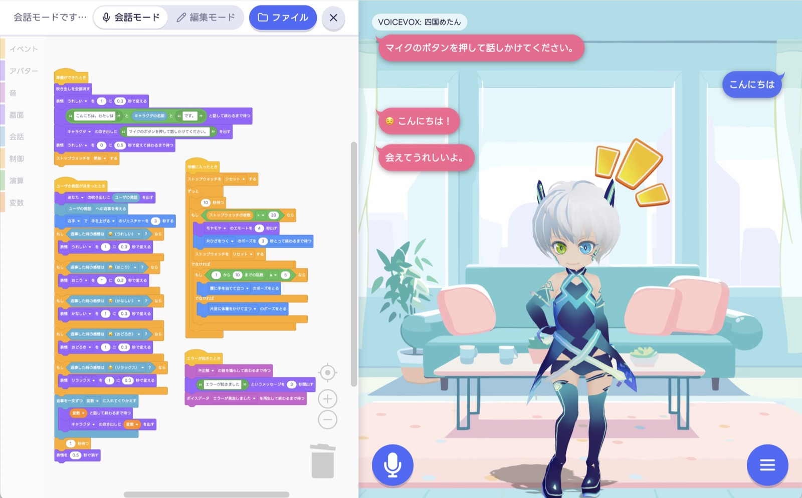

# VRMTalker

ブラウザ上で、VRM 3D モデルのアバターと声で会話できるようになるプロジェクトです。
そのままでもお使いいただけますが、自分で用意したアバターを使ってオリジナルのシステムを作るのにもお役立てください。



話しかけた言葉を聞き取り（音声認識）、返事を考え（LLM）、声にして（音声合成）、
アバターが口を動かして話します。ここまでを、自分のパソコンの中だけで動かせます。
アバターの動き方は、Scratch のようなブロックを並べる（ビジュアルプログラミング）ことで組み替えられます。

- 返事を考える LLM は、同梱の **llama.cpp** で手元で動かせます（ビルド不要）
  OpenAI などのサーバー側の LLM にも切り替えられます。
- 声（音声合成）は **VOICEVOX CORE** で手元で作ります（インストーラ不要）
- 聞き取り（音声認識）は Web Speech API で行います（Web Speech API はブラウザに内蔵されています）
- Mac / Windows / Linux で動作します

開発者向けの情報は [docs/development.md](docs/development.md)、サーバーとして
公開する方法は [docs/deployment.md](docs/deployment.md) にまとめています。

## 必要なもの

- Python 3.10 以上
- Python のパッケージマネージャー [uv](https://docs.astral.sh/uv/)
- 音声認識（Web Speech API）が使えるブラウザ。Google Chrome、Microsoft Edge で
  確かめています。ボタンを押さずに話しかける「連続対話」モードも存在しますが、
  このモードは新しい版の Chrome と Edge でお使いいただけます（[FAQ](#連続対話がオンにできない) を参照）
- 同梱の LLM を使う場合は、モデルを置くためにストレージに約 1.5GB の空きが必要になります

## セットアップ

Python のパッケージマネージャー uv を利用します。
uv が使える状態になっていない場合は、以下の操作を行う前に uv のインストールを行なってください。

```bash
uv sync
```

```bash
uv run python scripts/setup_voicevox.py
```

```bash
uv run python scripts/setup_llama.py
```

`setup_voicevox.py` は VOICEVOX の実行に必要なファイル一式（約 175MB）を
`voicevox_core/` にセットアップします。実行時に利用規約への同意を求められるので、
内容を確認して判断してください。

`setup_llama.py` は llama.cpp の事前ビルド済みバイナリ（約 10MB）と
GGUF モデル（LFM2.5-2.6B Q4_K_M、約 1.5GB）を `llama/` にセットアップします。

その他必要なライブラリは同梱しています。改めてインストールする必要はありません。
CDN からライブラリの読み込みを行わないので、LLM を手元で動かす（＝ローカル LLM を使用する）ことで、
インターネットの利用を最小限に抑えることができます。
※ インターネットは、音声認識を行う時のみ必要となります。（音声認識は、Google 等、ブラウザの開発元のサーバーで実行されます）


## 起動

```bash
./start.sh
```

または、次のようにコマンドラインを打ち込んでください。

```bash
uv run uvicorn main:app --port 8000
```

http://localhost:8000 をブラウザで開いてください。

※ 設定ファイル `.env` が存在する場合は、`start.sh` をお使いください。
- `start.sh` を使うと  `.env` の設定（合言葉や LLM の切り替え）を読み込んでから起動します。
- `.env` は `.env.example` を参考に作成してください。

## 使い方

### 話しかける

画面左下のマイクのボタンを押して話しかけてください。聞き取った言葉に、アバターが
返事をします。返事を考えている間は、アバターの頭の上に考え中の吹き出しが出ます。

設定で「ボタンを押さずに話しかける（連続対話）」をオンにすると、マイクのボタンを
1 回押すだけで、話しかけるたびに聞き取るようになります（もう一度押すと終わります）。
アバターが話している間は聞き取らないので、アバター自身の声を拾うことはありません。

### メニュー

画面右下のボタンを押すと、メニューが開きます。

| 項目 | 内容 |
|---|---|
| はじめから実行 | アバターの動きを、最初（「準備ができたとき」）からやり直します |
| 会話履歴をクリア | 画面の吹き出しと、キャラクタが覚えている前のやり取りを消します |
| ブロックで編集する | アバターの動き方を組み替える画面を開きます（[下を参照](#アバターの動き方を組み替える)） |
| 設定 | キャラクタの近さ、話者（声）、吹き出しの色、表示、キャラクタの名前と性格、話しかけ方を変えられます |
| 謝辞 | 素材とソフトウェアの出典、3D モデルの情報を見られます |

設定は「保存」を押すと、お使いのブラウザに記録されます。「破棄」を押すと初期値に戻ります。

### 話者（声）を変える

メニューの「設定」の「話者」で選んでください。最初から入っている音声モデル
（`0.vvm`）では、四国めたん・ずんだもん・春日部つむぎ・雨晴はうの 4 人の、
合わせて 10 種類の声（スタイル）を選べます。選べる声の一覧は、起動したあとに
http://localhost:8000/api/speakers を開いても確かめられます。

ほかのキャラクタの声を使いたいときは、[FAQ](#音声モデルを追加したい) をご覧ください。

### アバターの動き方を組み替える

メニューの「ブロックで編集する」を押すと、画面の左側にブロックの編集画面が開きます。
「〜のとき」のブロックの下に並べたブロックが、そのときに上から順に動きます。

- **会話モード**：話しかけると、組んだブロックが動きます。このモードでは、
  ブロックを組み替えられません
- **編集モード**：ブロックを組み替えられます。ブロックをクリックすると、その場で
  動きを試せます（動いている間にもう一度クリックすると止まります）

編集画面の「ファイル」から、組んだものをお使いのパソコンにファイルとして保存したり、
保存したファイルを読み込んだりできます。サーバーに公開して、ほかの人と共有する
こともできます（公開には合言葉が必要です。
[docs/deployment.md](docs/deployment.md#アクションの公開) をご覧ください）。

つまずきやすい組み方（返事のブロックを、同じきっかけの複数の並びに置くなど）を
すると、ブロックの左上に「！」のマークが付きます。マークを押すと、説明が出ます。

### 素材を入れ替える

アバターの動き・アイコン・音・背景・声は、種類ごとに用意した「定義ファイル」で、
何を使えるかを決めています。定義ファイルは JSON という形式で書かれたテキスト
ファイルで、ふつうのテキストエディタ（メモ帳など）で編集できます。
ブロックのドロップダウン（選択肢の一覧）に並ぶのもこの中身なので、
**素材のファイルを置いて、定義ファイルに 1 行足せば、その場で選べるようになります**。

| 種類 | 定義ファイル | 素材の置き場所 |
|---|---|---|
| モーション | `public/animations/motions.json` | `animations/vrma/` `animations/fbx/` |
| ポーズ・ジェスチャー | `public/animations/poses.json` `public/animations/gestures.json` | （素材のファイルはありません。下をご覧ください） |
| エモート（頭の上のアイコン） | `public/emotes/emotes.json` | `public/emotes/` |
| 効果音 | `public/sounds/sounds.json` | `public/sounds/` |
| ボイスデータ | `public/voices/voices.json` | `public/voices/` |
| 背景 | `public/backgrounds/backgrounds.json` | `public/backgrounds/` |

定義ファイルは、どれも同じ形で書きます。

```json
[
    { "id": "applause", "name": "拍手", "file": "./sounds/applause.mp3" }
]
```

| 項目 | 内容 |
|---|---|
| `id` | 組んだアクション（ブロック）が覚えておく名札です。**あとから変えないでください**（保存済みのアクションで選んでいたものが外れてしまいます） |
| `name` | 画面に出す名前です。こちらはあとから変えてもかまいません |
| `file` | 素材のファイルの場所です。`public/` フォルダから見た場所を書きます |

`id` は、半角の英数字とハイフン（`-`）で付けておくと扱いやすくなります
（ファイル名に合わせると楽です）。

種類ごとの違いは次のとおりです。

- **モーション**は、定義ファイルに書いたものを起動時にすべて読み込むので、
  使うものだけを書いてください。歩く・走るのように、一歩分の動きをくり返す
  モーションには `"loop": true` を付けます。動きの最後から最初へのつなぎ目が
  滑らかになり、ブロックで続けて再生すると、切れ目なく歩き続けます
  （違うモーションへも、待機の姿勢を挟まずにつながります）
- **待機の姿勢**（何もしていないときの姿）は、ポーズの 1 つに `"default": true` を
  付けて決めます（同梱の定義では「まっすぐ立つ」）。呼吸と小さな揺れが付きます。
  ポーズの代わりに、くり返し再生するモーションを待機の姿勢にしたいときは、
  `poses.json` の `default` を外し、`motions.json` のモーションの 1 つに
  `"default": true` を付けてください
- **ボイスデータ**は、アバターの声として鳴ります。口が動き、「話すのをやめる」の
  ブロックで止まります
- **効果音**は、場を盛り上げるための音です。口は動かず、いくつも重ねて鳴らせます
- **背景**は、切り替えるときに 0.6 秒かけて、じわっと入れ替わります。
  最初に出す絵は、`index.html` の `#screen` で決めています
- **ポーズ**（全身の姿勢）と**ジェスチャー**（腕と手の身ぶり）は、素材のファイルを
  置く代わりに、`file` の欄が `template` になっています。値には
  [TalkingHead](https://github.com/met4citizen/TalkingHead) の動きの名前を書きます。
  ポーズは `straight` `side` `hip` `turn` `back` `wide` `bend` `oneknee` `kneel`
  `sitting`、ジェスチャーは `handup` `index` `ok` `thumbup` `thumbdown` `side`
  `shrug` `namaste` から選べます。並べ替え、名前の変更、選択肢から外すことは
  自由に行えます
  ```json
  { "id": "sitting", "name": "床に座る", "template": "sitting" }
  ```
  ポーズは、待機の姿勢の代わりになります。ポーズをとっている間に再生した
  モーションは、終わるとポーズへ戻ります。立った姿勢と低い姿勢（ひざまずく・
  床に座る）の間は、片ひざをつく姿勢を 1 秒はさんで移ります。ジェスチャーは、
  モーションやポーズの上から重ねて動きます

素材の出典は `public/acknowledgment.md` に記載しています。この内容はメニューの
「リソースの出典」にそのまま表示されます。素材を差し替えた場合は、こちらの内容も
修正してください。

## LLM を切り替える

最初の設定では、同梱の llama.cpp（llama-server）を自動で起動して、返事を考えます。
OpenAI などのサーバー側の LLM を使うときは、環境変数（起動するときにアプリへ渡す
設定）で切り替えます。

| 環境変数 | 最初の値 | 内容 |
|---|---|---|
| `LLM_BACKEND` | `local` | `local`（同梱の llama-server）／ `remote`（サーバー側の LLM）／ `echo`（LLM を使わず、話しかけた言葉をそのまま返すだけ） |
| `LLM_BASE_URL` | – | `remote` のときの接続先（エンドポイント） |
| `LLM_MODEL` | `local-model` | モデルの名前 |
| `LLM_API_KEY` | – | `remote` のときの API キー |
| `LLM_SYSTEM_PROMPT` | （`src/llm/__init__.py` をご覧ください） | 最初のキャラクタの性格（設定ウインドウからも変えられます） |

`.env.example` を写して `.env` という名前のファイルを作り、中身を書き換えて
`./start.sh` で起動すると、その設定が読み込まれます。`.env` は Git に入りません
（API キーなどを書いても、公開されません）。

`.env` を使わずに、起動するときに直接指定することもできます。

```bash
LLM_BACKEND=remote \
LLM_BASE_URL=https://api.openai.com/v1 \
LLM_MODEL=gpt-4o-mini \
LLM_API_KEY=sk-... \
uv run uvicorn main:app --port 8000
```

OpenAI と同じ形の API（OpenAI 互換の API）であれば、vLLM・Ollama・Azure OpenAI・
Gemini なども使えます（`.env.example` に例があります）。

## FAQ

### 別のアバターを使いたい

VRM 形式のモデル（VRM 0.0 と VRM 1.0 のどちらも使えます）であれば、差し替えて使えます。

1. モデルのファイル（`.vrm`）を `public/models/` に置きます
2. `public/index.html` の `<vrm-avatar src="./models/ChibiVita.vrm"` の部分を、
   置いたファイルの名前に書き換えます

モデルを使う前に、そのモデルの利用条件（改変・再配布・商用利用など）を必ず
確かめてください。起動したあとに、メニューの「3D モデルの情報」でも確かめられます。
また、差し替えたら `public/acknowledgment.md` の出典も直してください。

体格の違うモデルでは、頭の上のアイコンの位置などの調整が必要になることがあります。
詳細は [docs/development.md](docs/development.md#アバターvrm-モデルを差し替える) を
ご覧ください。

### オンライン会議・画面共有で使うには

VRMTalker のウィンドウは、**隠さずに見える状態にしておいてください**。ブラウザは、
見えていないページ（後ろに隠れたタブ、最小化したウィンドウ、ほかのウィンドウに
すっかり覆われたウィンドウ）の描画を止めてしまうためです。

- VRMTalker は、会議のアプリとは別のウィンドウで開いてください（同じウィンドウの
  別のタブだと、会議を見ている間は後ろに隠れてしまいます）。開いたウィンドウは、
  会議のウィンドウと横に並べるか、ディスプレイが 2 台以上あれば、別のディスプレイに
  置いてください
- 画面共有では、共有するものとして VRMTalker を開いている**タブ**を選び
  （Chrome では「Chrome タブ」の中にあります）、「タブの音声も共有」を有効に
  してください。アバターの声がマイクを通らずに、相手へ直接届きます
  - 「ウィンドウ」を選ぶと、映像だけが共有され、アバターの声は届きません
  - タブの音声を共有できるのは、Chrome や Edge などです。Firefox や Safari には、
    この機能がありません
  - 会議をブラウザで開いている場合、選べるのは会議と同じブラウザのタブです。
    VRMTalker も同じブラウザで開いてください
  - 会議のアプリ（Zoom や Teams のデスクトップ版など）を使う場合は、そのアプリの
    「コンピューターの音声を共有」などの設定をお使いください
- ヘッドホンの使用を推奨します（音声認識が相手の声を拾ったり、あるいは、会議のアプリが
  アバターの声を拾ってしまう現象を防ぐためです）
- それでもマイクの取り合いで会議の音声に不具合が発生する場合は、会議を別のブラウザで
  開いてください。ただしこの場合は、会議のブラウザから VRMTalker のタブを選べない
  ため、タブの音声の共有は使えません。アバターの声も相手に届けたいときは、会議の
  アプリ（デスクトップ版）の「コンピューターの音声を共有」などをお使いください

VRMTalker のウィンドウが隠れても、会話は止まりませんが、モーションやジェスチャーの
「終わるまで待つ」の実行に、最大で 1 秒ほどの遅れが生じます。5 分以上隠れたままになると、
1 分ほどの遅れが生じることがあります（仕組みは
[docs/development.md](docs/development.md#画面が隠れているときの動き) をご覧ください）。

### 返事が遅い

`llama/models/` にある LLM のモデルのファイル（GGUF という形式）を差し替えると、
別のモデルを使えます。モデルのファイルは、1 つだけ置いてください。
次のコマンドで、Hugging Face で公開されているモデルを取得できます。

```bash
uv run python scripts/setup_llama.py --model-repo <HFリポジトリ> --model-file <ファイル名>
```

**推論（thinking）モデルにはご注意ください**。推論モデルは、返事の本文の前に、
数秒ぶんの「考える過程」を出力するため、最初の一言までの待ち時間が長くなります。
最初の設定では `--reasoning-budget 0` で、この考える過程を止めています
（LFM2.5 での実測では、止めないと最初の一言まで 5〜14 秒、止めると 0.3〜0.5 秒でした）。
考える過程を使いたい場合は、環境変数 `LLAMA_REASONING_BUDGET=-1` を指定してください。

そのほか、調整に使える環境変数として `LLAMA_CTX_SIZE` / `LLAMA_THREADS` /
`LLAMA_HOST` があります。

### GPU で LLM を動かしたい

同梱の llama.cpp は、どの環境でも **CPU 版**を取得します。GPU 版
（CUDA / Vulkan / ROCm / SYCL）は、お使いのパソコンでどれが使えるかを自動で
決められないため、取得していません。GPU 版を使いたい場合は、
[llama.cpp のリリースページ](https://github.com/ggml-org/llama.cpp/releases)から
お使いの環境に合うものを取得して、`llama/bin` の中身を置き換えてください。

`setup_llama.py` が取得するものは次のとおりです。

| 環境 | 取得するもの |
|---|---|
| macOS | `llama-<版>-bin-macos-arm64 / x64.tar.gz` |
| Windows | `llama-<版>-bin-win-cpu-arm64 / x64.zip` |
| Linux | `llama-<版>-bin-ubuntu-arm64 / x64.tar.gz` |

Linux 向けは、Ubuntu でビルドされたものが配られています。ほかの Linux
（ディストリビューション）でも動くことが多いですが、glibc（基本的なライブラリ）が
古い環境では動かないことがあります。

### ポート 8080 がほかのもので使われている

同梱の llama-server は、最初の設定では `127.0.0.1:8080`（このパソコンの 8080 番の
ポート。ポートは通信の窓口の番号です）を使います。**8080 番がほかのアプリで
使われている場合は、環境変数 `LLAMA_PORT` で番号を変えてください**（アプリが
つなぎに行く先も一緒に変わるので、指定はこれ 1 つで足ります）。

```bash
LLAMA_PORT=8099 ./start.sh
```

### 音声モデルを追加したい

最初の設定では、音声モデル `0.vvm` だけを取得します。すべての音声モデルを
取得するには、次のコマンドを実行してください。

```bash
uv run python scripts/setup_voicevox.py --models-pattern "*"
```

### 別の環境（別の OS）へ移したい

`voicevox_core/` の中身は、次のように分かれています。

| フォルダ | 内容 | OS ごとに違うか |
|---|---|---|
| `c_api/` | VOICEVOX CORE の本体 | 違う |
| `onnxruntime/` | 音声を作る計算に使う部品（推論ランタイム） | 違う |
| `dict/` | 読み方の辞書（Open JTalk 辞書） | 同じ |
| `models/` | 音声モデル `.vvm` | 同じ |

移す先の OS 向けのファイルは、今の環境から前もって取得できます。

```bash
uv run python scripts/setup_voicevox.py --os windows --cpu-arch x64
```

`.venv/`（uv が作る Python の環境）は OS ごとに違うため、そのままコピーしても
使えません。移した先で `uv sync` を実行してください。

### マイクが使えない（別のパソコンからつないだとき）

`localhost` 以外のアドレス（LAN の IP アドレスなど）へ、暗号化しない通信
（`http://` で始まるアドレス）でつなぐと、ブラウザがマイクを使わせてくれません。
ほかのパソコンから使うときは、暗号化した通信（HTTPS）で公開する必要があります
（[docs/deployment.md](docs/deployment.md) をご覧ください）。

### 連続対話がオンにできない

連続対話では、マイクの音を音声認識に直接渡す機能（Web Speech API の
`start(audioTrack)`）を使っています。今のところ、この機能に対応しているのは、
新しい版の Chrome と Edge だけです。連続対話をオンにすると、お使いのブラウザで
使えるかを確かめ、使えなければ「このブラウザは対応していませんでした」と出して、
オフに戻します。その場合は、マイクのボタンを押すたびに 1 回聞き取る使い方に
なります。

## クレジット表記について

VOICEVOX の利用規約により、作った音声を使うときは、**VOICEVOX を使ったことが
わかるクレジット表記が必要です**。使ったキャラクターごとの表記も求められます。

> VOICEVOX:四国めたん

VRMTalker では、この表記を画面左上に表示しています（[public/index.html](public/index.html)
の `#credit`）。話者を変えると、表記も合わせて変わります。

各音声ライブラリの規約は、[VOICEVOX 公式サイト](https://voicevox.hiroshiba.jp/)
と `voicevox_core/models/TERMS.txt` をご覧ください。

## ライセンス

このプロジェクトのソースコードは [MIT License](LICENSE) です。同梱しているもの、
セットアップで取得するもののライセンスは次のとおりです。

- VOICEVOX CORE 0.16 以降のビルド済みコアライブラリ：MIT License
  （0.16 より前の版は、別のライセンスなのでご注意ください）
- ポーズとジェスチャーの定義（`talkinghead-templates.js`）：
  [TalkingHead](https://github.com/met4citizen/TalkingHead) の MIT License
  （Copyright (c) 2023-2024 Mika Suominen）。許諾の表示はファイルの先頭にあります
- 音声モデル・音声ライブラリ：上の「クレジット表記について」をご覧ください
- `public/vendor/` のライブラリ：three.js・three-vrm・three-vrm-animation・marked・
  ONNX Runtime Web・Silero VAD のモデルは MIT License、
  Blockly（画像・効果音を含む）は Apache License 2.0 です。
  ライセンスの写しを、それぞれのフォルダに置いています
- 素材（モデル・モーション・絵・音）：`public/acknowledgment.md`（画面のメニューの
  「リソースの出典」）をご覧ください
